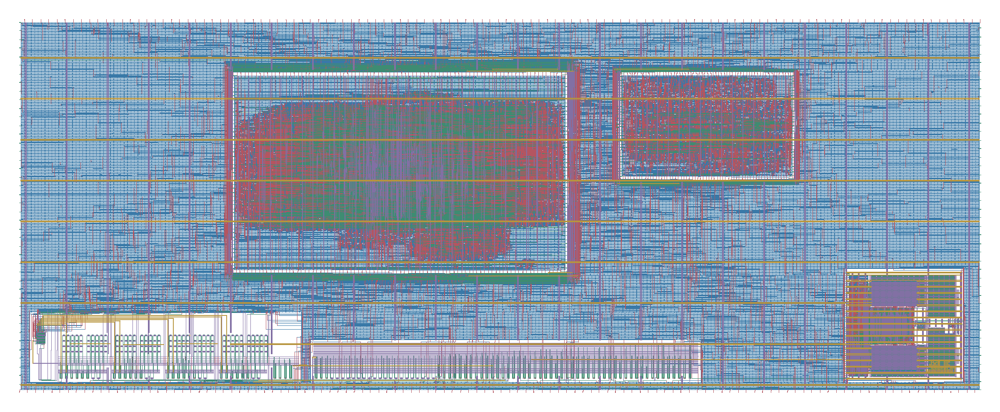
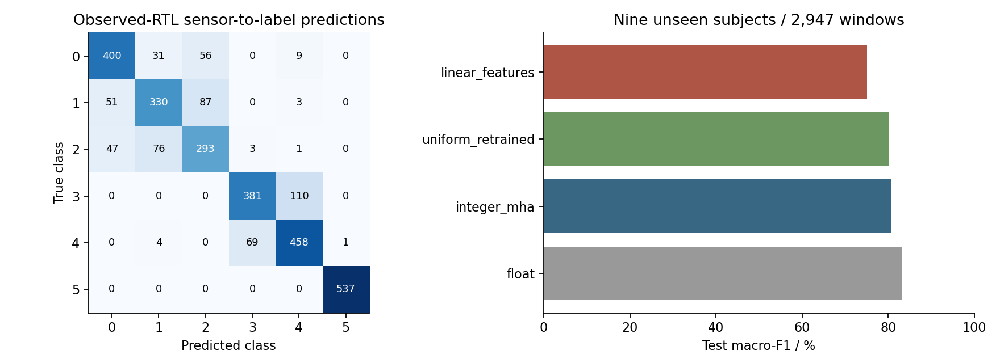
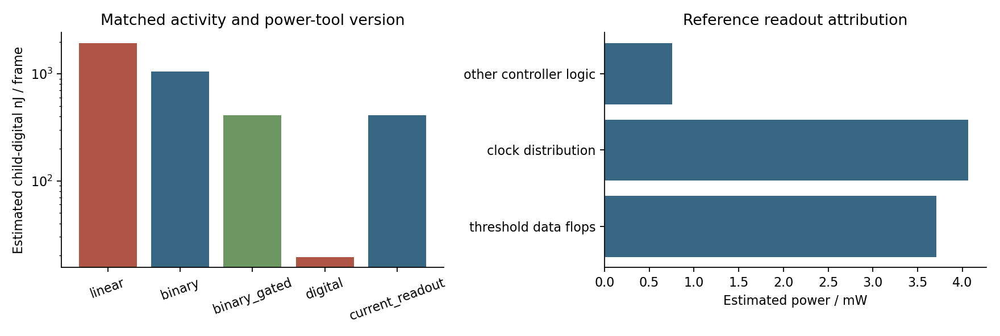

# AutoMX-CIM: An MXFP4–Ternary Mixed-Signal Compute-in-Memory Core for Attention Projections

Copyright 2026 EDABK Laboratory.

**Code-a-Chip · ISSCC 2027** — Hanoi University of Science and Technology.
Lead/contact: **Minh D. Nguyen**, <minh.nguyenduc1@hust.edu.vn>.
Team: Minh D. Nguyen, Tien Thinh Nguyen, Dang Vinh Pham and Anh Tu Phung.
Designated award representative: **Dang Vinh Pham**, <dangvinh290105@gmail.com>,
to receive the award, attend ISSCC 2027 in person and present the project poster if selected.

Open **[AutoMX_CIM_Code_a_Chip.ipynb](AutoMX_CIM_Code_a_Chip.ipynb)**.
Its saved outputs include all 205 executed code cells, measured tables,
simulator/tool logs and 49 embedded images. Reading the completed notebook
does not require an EDA installation or a new execution.



## Design and measured results

A register-programmed eight-NMOS ternary projection leaf feeds analog
acquisition, a real SAR controller, calibration/readout and a synthesizable
two-head multi-head attention IP. The notebook builds the design from MOS
branches to the five-block layout and a wearable activity application.

| Experiment | Recorded result |
|---|---|
| Wearable application | 2,947 official test windows, nine unseen subjects; 81.405% accuracy and 80.706% macro-F1 |
| RTL application equivalence | Four paths, 2,947 frames and 23,576 values per path; zero mismatches |
| Transistor/SAR/MHA partition | Six fixed class-selected frames, 384 conversions; zero partial/output mismatches under the declared ideal-50-ps stimulus |
| Calibration-storage clock gating | 60.943426% additional reduction in matched child-digital energy, with output/clock/ICG timing checks |
| Complete laboratory execution | 509 cells, 205 code cells with output, zero execution errors; 154.68 minutes on the recorded host |
| Physical result | Five-block GDS, routed timing/rails/connectivity reports and stable KLayout overview/detail renders |

The native conversion result uses a timing-aligned ideal-50-ps activation
unit. The digital baseline remains faster and lower-energy at this small
size. Energy tables retain their measured ownership windows; a
complete-chip energy advantage is not claimed.

### Wearable application and RTL verification

All models below use the same official UCI HAR test split: 2,947 windows
from nine unseen subjects. The test split was not used to select the model.

| Model | Test accuracy | Test macro-F1 |
|---|---:|---:|
| Linear features | 75.704% | 75.111% |
| Retrained uniform attention | 80.964% | 80.292% |
| AutoMX integer MHA | **81.405%** | **80.706%** |
| Floating-point attention reference | 83.814% | 83.224% |

The four RTL paths each process all 2,947 frames and reproduce all 23,576
reference output values with **zero mismatches**. Feature extraction,
embedding and the final classifier run in software; the two-token,
four-channel, two-head attention datapath runs in RTL. Weight masks are
held in controller registers; the eight-NMOS leaf implements the signed
projection branches.



Sources: [application metrics](results/final_run/priority_application/application/application_metrics.json),
[subject-paired comparisons](results/final_run/priority_application/application/paired_subject_comparison.json)
and [sensor-to-label RTL verification](results/final_run/electrical_closure/application_service/verification.json).

### Matched controller energy and latency

The following comparison uses the same six class-selected frames at
25 MHz, SKY130 TT, 1.8 V and 25 °C. Every variant has zero output mismatches.

| Variant | Latency (µs/frame) | Estimated child-digital energy (nJ/frame) |
|---|---:|---:|
| Linear decode | 186.140 | 1,936.549 |
| Binary decode | 102.593 | 1,055.528 |
| Binary decode with calibration-data clock gating (selected) | **102.593** | **412.253** |
| Serial ternary digital baseline | 8.860 | 19.433 |

Calibration-data clock gating reduces the estimated child-digital energy
by **60.943426% relative to binary decode**, with unchanged frame latency
and outputs. The checks include actual threshold-flop clock activity and
positive ICG enable setup/hold slack of **+10.079 ns / +3.759 ns**.

Energy uses OpenSTA 3.1, VCD-annotated child gate netlists and extracted
child RC. Its scope excludes parent clock distribution and I/O, analog
rails, SAR digital control, external drivers, initialization and host work.
These are active child-digital subtotals, rather than whole-chip energy.



The readout area's synthesis and routing measurements are reported
separately from hard-macro footprints and whole-chip area:

| Readout variant | Mapped standard-cell area (µm²) | Routed standard-cell area (µm²) |
|---|---:|---:|
| Binary reference | 167,519.414 | 243,070.624 |
| Calibration-data clock gating (selected) | 175,447.018 | 245,122.592 |

Sources: [matched implementation comparison](results/final_run/electrical_closure/implementation_comparison.json),
[area verification](results/final_run/electrical_closure/controller_adc_area/verification.json)
and [measured outcome report](docs/PRIORITY_CLOSURE_RESULTS_20261029.md).

### Passed analog-partition and reproduction checks

| Check | Passed result | Verified scope |
|---|---|---|
| Nominal calibration holdouts | 0 wrong across 88 held-out cases and 8 anchor rechecks | Timing-aligned ideal-50-ps stimulus; calibrated signed partial sums |
| Condition-specific recalibration | 0 wrong across 196 held-out checks after five-anchor interpolation | Seven sampled PVT conditions; ideal-50-ps analog/timing diagnostic |
| Native transistor/SAR application partition | 6 class-selected frames, 384 conversions, 0 partial/output mismatches | Native acquisitions followed by request-tagged MHA/readout replay |
| Short package check | 2,947 frozen windows re-evaluated; 6 frames through 4 actual RTL paths; GDS hierarchy checked | Separate short check; recorded runtime 3.88 seconds on the original host |
| Recorded complete execution | 509 cells, 205 executed code cells with output, 49 embedded images, 0 execution errors | Full laboratory run recorded in 154.68 minutes; 3 artifact auditors passed |

The PVT result describes the sampled recalibration experiment, rather than
a statistical mismatch/yield study. The short package check and stored
notebook outputs have separate coverage from a fresh complete Run All.

Sources: [native electrical verification](results/final_run/electrical_closure/electrical/verification.json),
[sampled PVT records](results/final_run/electrical_closure/electrical/pvt.json),
[short-check receipt](results/final_run/electrical_closure/quick_review/verification.json)
and [recorded execution receipt](results/execution/FINAL_RELEASE.json).

## Reproduction

[Reproduction instructions](docs/REPRODUCIBILITY.md) cover Python, native
dependencies, the pinned runtime-input archive and fresh Run All on Linux
x86-64 with Docker and the documented native tools. Runtime inputs are
distributed separately from this Git checkout. Obtain the prepared archive
from the [Google Drive reproduction-assets folder](https://drive.google.com/drive/folders/182dkLchafQBx1tNYUVZpyNpNAvFWwNjB?usp=drive_link),
then restore it before Run All:

| Archive in the Drive folder | Size (bytes) | Purpose |
|---|---:|---|
| `AutoMX_CIM_runtime_inputs_20261030.tar.gz` | 1,454,841,643 | Required inputs for a fresh complete run |
| `AutoMX_CIM_measurement_records_20261029.tar.gz` | 429,895,973 | Optional detailed records for reviewing the completed run |

Download the runtime archive from the folder to your Linux host and pass
its local path to `--archive`. See [reproduction assets](RELEASE_ASSETS.md)
for the contents and download procedure.

```bash
conda env create -f environment.yml
conda activate automx-review
export AUTOMX_PYTHON="$CONDA_PREFIX/bin/python"
python scripts/restore_runtime.py --archive /path/to/AutoMX_CIM_runtime_inputs_20261030.tar.gz
./run_notebook.sh
# Restart Kernel & Run All; or execute headlessly:
./run_all.sh
```

A smaller check re-evaluates the frozen 2,947-window fixture, runs six frames
through four actual RTL paths and reads the selected GDS using KLayout:

```bash
python scripts/restore_runtime.py --layouts-only
python scripts/quick_review.py --root . --work /tmp/automx_submission_review
```

The short check does not rerun model training, transistor acquisition or
physical routing. Each full run creates a new `runs/fresh_*` directory.

## Files and evidence

- `rtl/`, `ip/automx_mha/`, `automx_cim/`, `scripts/`, `third_party/`: design, references and executable flow.
- `exports/`: compressed GDS, stable renders and reusable MHA source-IP archive; the selected five-block view is shown above.
- `results/final_run/`: selected numerical reports, CSV tables and native-tool transcripts from the final completed run.
- `results/execution/`: original execution receipt, complete execution log and three artifact-auditor logs. Absolute paths in these files identify the original acquisition host.
- [Reproduction assets](RELEASE_ASSETS.md) and `runtime_assets.json`: archive names, contents and download metadata. Large runtime dependencies and detailed measurement records are distributed through the linked Google Drive folder.
- `data/checkpoints/`: source/reference fixtures for the circuit experiments. `data/source_notebook_cell_ids.json` retains cell identifiers for the preservation audit.

[Measured outcomes](docs/PRIORITY_CLOSURE_RESULTS_20261029.md),
[operating contract](docs/CIM_SAR_MHA_OPERATING_CONTRACT.md) and
[measurement tools](docs/MEASUREMENT_TOOLCHAIN.md) describe the experiment
scopes. References are in the notebook and `data/notebook_references.md`.
Source reuse is documented in [NOTICE.md](NOTICE.md) and `licenses/`.
Original notebook/package content is Apache-2.0; upstream components retain
their own licenses. Author metadata is in `TEAM.json` and `CITATION.cff`.

## References

**[1]** <a id="ref-1"></a>A. Vaswani et al., [“Attention Is All You Need,”](https://arxiv.org/abs/1706.03762) 2017, arXiv:1706.03762. Source for scaled dot-product attention and multi-head Q/K/V/O equations.

**[2]** <a id="ref-2"></a>Open Compute Project, [*OCP Microscaling Formats (MX) Specification*, Version 1.0,](https://www.opencompute.org/documents/ocp-microscaling-formats-mx-v1-0-spec-final-pdf) September 2023, §§5.2, 5.3.3, 5.4.1. Source for MXFP4 blocks, E2M1 elements, and E8M0 shared scales. The notebook documents its own quantizer tie policy beside the codec.

**[3]** <a id="ref-3"></a>F. Li et al., [“Ternary Weight Networks,”](https://arxiv.org/abs/1605.04711) 2016, arXiv:1605.04711. Background on scaled −1/0/+1 weight representations; the project defines its own transistor-control encoding and 8T netlist.

**[4]** <a id="ref-4"></a>Analog Devices, [“Understanding SAR ADCs: Their Architecture and Comparison with Other ADCs,”](https://www.analog.com/en/resources/technical-articles/successive-approximation-registers-sar-and-flash-adcs.html) October 2, 2001. Background for sample/hold, trial DAC codes, comparator decisions, and SAR-register updates.

**[5]** <a id="ref-5"></a>SKY130_SAR-ADC1 project, [*Fully differential asynchronous non-binary 12-bit SAR ADC in SKY130*.](https://github.com/efabless/SKY130_SAR-ADC1) Reused ADC circuit, SAR control, decoder, and oversampling RTL; the repository identifies its [iic-jku upstream](https://github.com/iic-jku/SKY130_SAR-ADC1). Local sources and retained licenses are documented in `NOTICE.md` and `third_party/SKY130_SAR_ADC1/`.

**[6]** <a id="ref-6"></a>SkyWater SKY130 PDK, [*Physical & Design Verification documentation*.](https://skywater-pdk.readthedocs.io/en/main/verification.html) Process context for device models, layout rules, extraction, and physical verification. Bundled process inputs are identified in `standalone.json` and supplied under `pdks/`; retained upstream license texts are in `licenses/`.

**[7]** <a id="ref-7"></a>ngspice project, [*Documentation and User's Manual*.](https://ngspice.sourceforge.io/docs.html) Transistor-level DC/transient analysis, measurements, and shared-library co-simulation interfaces.

**[8]** <a id="ref-8"></a>Icarus Verilog project, [*Icarus Verilog documentation*.](https://steveicarus.github.io/iverilog/) `iverilog` compilation and `vvp` execution for SAR/controller/MHA tests and state-trace replay.

**[9]** <a id="ref-9"></a>YosysHQ, [*Yosys documentation*.](https://yosyshq.readthedocs.io/projects/yosys/en/latest/) RTL synthesis, hierarchy checks, Liberty technology mapping, and mapped-cell statistics.

**[10]** <a id="ref-10"></a>M. Shalan and T. Edwards, “Building OpenLANE: A 130nm OpenROAD-based Tapeout-Proven Flow,” ICCAD, 2020; publication and flow sources listed in the [official OpenLane repository](https://github.com/The-OpenROAD-Project/OpenLane#publication). Used for the RTL-to-GDS implementation flow; the executed container image is recorded in `standalone.json`.

**[11]** <a id="ref-11"></a>The OpenROAD Project, [*OpenROAD documentation*](https://openroad.readthedocs.io/en/latest/) and [*Parasitics Extraction — OpenRCX*.](https://openroad.readthedocs.io/en/latest/main/src/rcx/README.html) Physical implementation, routed databases, and extracted resistance/capacitance exported as SPEF.

**[12]** <a id="ref-12"></a>The OpenROAD Project, [*OpenSTA*.](https://github.com/The-OpenROAD-Project/OpenSTA) Liberty/SDC/SPEF-based timing analysis, including the hierarchical gate-netlist checks used here. The activity comparison uses the pinned OpenSTA 3.1.0 build recorded in `tools/opensta_current/tool.json` and `read_vcd`; clock-activity checks independently verify the gated threshold bank.

**[13]** <a id="ref-13"></a>KLayout project, [*KLayout documentation*.](https://www.klayout.de/doc/) GDS hierarchy/geometry inspection, layer-controlled rendering, and scripted layout checks.

**[14]** <a id="ref-14"></a>T. Edwards and contributors, [*Magic VLSI Layout Tool*.](https://github.com/RTimothyEdwards/magic) Layout/extraction tooling, including the DEF/LEF signal extraction used for the top-level LVS comparison.

**[15]** <a id="ref-15"></a>T. Edwards and contributors, [*Netgen*.](https://github.com/RTimothyEdwards/netgen) SPICE/Verilog netlist comparison and LVS verdicts.

**[16]** <a id="ref-16"></a>J. Reyes-Ortiz et al., [*Human Activity Recognition Using Smartphones*, UCI Machine Learning Repository](https://archive.ics.uci.edu/dataset/240/human+activity+recognition+using+smartphones), 2013, DOI 10.24432/C54S4K, CC BY 4.0. Sensor windows, official subject-disjoint test split and retained dataset attribution are supplied under `data/`.

The CIM transistor topology, controller/readout integration, MHA RTL IP, and experiments are documented by the source cells and their adjacent measurements. External sources above provide numerical background, reused IP, process information, and tool documentation. Measured voltages, energies, areas, and timing values come from this notebook's logs and reports.
