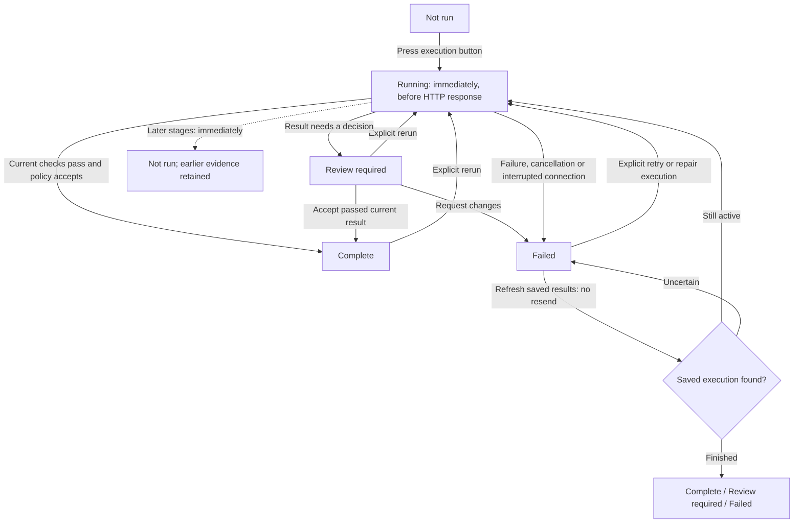

# Execution status and recovery

Updated 2026-10-21. These rules apply to all fourteen design-stage tabs. They describe GUI execution state; the saved tool checks and their scope remain the evidence for the circuit.

When a request cannot start, its specific reason and next action (historical development reference; not included in this curated archive) distinguish missing implementation, prerequisites, tool setup, connection and input. Queues and node tables follow the same policy; the legacy backend status is retained only in original evidence.

| Status | Meaning | Next action |
| --- | --- | --- |
| Not run | This stage has not completed for the current flow. Earlier results remain in history. | Read the prerequisite or run the stage when ready. |
| Running | The execution button was pressed and submission or execution is in progress. | Wait or inspect progress. |
| Complete | The required current checks passed and the result was accepted. For node stages, every required node must be complete. | Continue to the next stage. |
| Review required | Execution finished with a result awaiting a review decision. | Inspect the checks, then accept or request changes. |
| Failed | Submission, execution or required checks failed; interruption and cancellation also use this state with a specific reason. | Read the saved error and use repair, configuration, retry or reconnect as indicated. |

The sidebar, main stage status, legend and review-section header use the same five labels, colors and symbols. Raw execution, validation, adoption and freshness values remain under **Execution details** and in the saved evidence. A failed check is displayed as **Failed** even when the tool process itself finished normally.

## Immediate transitions

Previewing context, reading history, saving settings, testing a connection and moving between tabs do not start a design execution. They do not invalidate later stages. Starting a real stage execution does invalidate the later-stage display immediately. Old polls cannot restore the earlier Complete display. Starting that later stage establishes its new execution state. The scoped browser ledger retains this distinction across reloads; it never deletes, rewrites or adopts backend records.

Graph Editor node coordinates and viewport are saveable presentation state, not execution input. If only `design.layout` differs from the saved design, the header reports **Unsaved canvas view · saved evidence unchanged** and current accepted stages remain visible and usable. Any non-layout design change, or an invalid verification draft, still requires saving and verification before current completion is shown or review actions are enabled.

A connection failure has a **Refresh saved results** action. It reads the saved request/run before any retry. It does not resubmit the execution automatically. Reopening after an interrupted submission also requires reconciliation with saved progress. An HTTP rejection is shown as a failed submission with its reason.

## Recover a failed S06 node

1. Open **06 Local Netlist Simulation**. **Next step** identifies the first repairable node. The node table and **Resolve node verification results** also offer per-node actions.
2. Read the actual mismatch and choose **Prepare repair for …** or **Prepare S04 RTL repair**.
3. S04 opens with the exact source candidate and a **Required correction** draft. It includes the failed S06 run, adopted S05 run and netlist hash, original-input/testbench hashes and diagnostic excerpt. This step sends no model request.
4. Review/edit the correction, select **Context Preview**, then explicitly start **Repair node RTL** when the provider is ready.
5. After the corrected candidate is accepted, rerun S05 and S06 for that candidate. A completed S04 check does not establish S06 circuit behavior.

Missing behavioral checker support is displayed separately from a failed circuit check. A tool setup error points to setup; a timeout or interrupted attempt can offer retry/reconnect. Repeated RTL generation is not presented as a remedy for an unimplemented checker. The complete saved console and history remain available.

The current eleven-node NPU has three current failed S06 nodes and eight nodes without supported behavioral checkers. This update adds status and recovery UI; it does not repair those circuits or implement the missing checkers. Verification record (historical development reference; not included in this curated archive).
