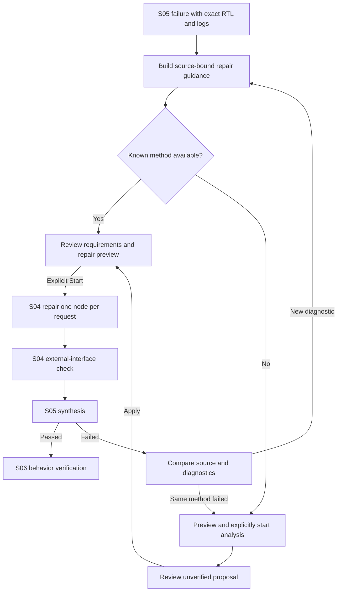

# RTL repair guidance and handling recurring failures

Latest checkpoint on 2026-10-16: unresolved-problem display and actual data (historical development reference; not included in this curated archive). Opening 04 shows each node's actual synthesis errors, RTL lines and proposed corrections consistent with the original specification before the instruction field. Inspect unresolved problems only reads evidence and moves focus; it creates no new preview or model request. At this checkpoint, the buffer and FIFO had not applied the instructed removal of the array reset, and their latest RTL was identical to the repair source. The display distinguishes the repeat guard from synthesis errors and makes the previous instruction, diff, earlier RTL and current RTL inspectable. The following sections record the preceding implementation.

For a node that failed S05, derive repair guidance from the original specification and actual diagnostics, review it, then pass it to S04 for RTL correction. S04 checks the external interface, S05 handles synthesis, and S06 verifies behavior against the original specification and saved inputs.

## Inputs to a repair request

A repair request includes the original node specification and required connection edges, failed RTL, actual tool diagnostics, concrete change guidance and the 2 most recent repair attempts. Candidate ID, RTL hash, S05 run, tool settings and original inputs are checked for correspondence so that diagnostics from another candidate or stale guidance are not applied.

Known rules cover whole-array assignments, untyped signed declarations, declarations inside unnamed blocks and conflicting drivers. Guidance identifies the relevant lines and requirements that must be preserved. For array resets, it does not propose replacing the reset with an initialization loop when the original specification requires retaining memory contents. Facts established by a rule are displayed separately from hypotheses about intent or ownership.

For unsupported diagnostics, a separate model-analysis request can be explicitly prepared and started. The model uses the currently configured Local or Network provider; the destination is not switched automatically. All analysis messages, profile, raw answer, events, usage, finish reason and errors are saved in a separate repair_analysis.json. Analysis alone changes neither RTL nor adoption state.

The model's analysis answer is checked for the required JSON format and references to source lines. Format and line-number checks do not prove the semantic correctness of a proposal. All model analysis is presented as a hypothesis and applied only to a repair request that keeps the original specification fixed.

## GUI operation

1. In S05, select **Preview repairs for all failed nodes** or prepare a repair for the selected node.
2. In S04, use **Read repair instructions** to inspect the original requirements, current RTL, diagnostics, change guidance, previous diff and result.
3. To proceed with known guidance, select **Start repair batch**. Repairs run sequentially, with 1 request per node.
4. For an unsupported diagnostic, or when guidance needs reconsideration, select **Preview model-assisted guidance**. Review the analysis messages and press **Start guidance analysis**.
5. Review the analysis raw answer and proposal, then select **Apply reviewed guidance to repair preview** to rebuild the repair request. Inspect the resulting preview before starting it.
6. Inspect the repaired candidate's S04 external-interface result, then resynthesize the current candidate in S05. Proceed to S06 after S05 passes.

Button eligibility is bound to the current saved inputs, candidate and profile. After a connection loss, reconnect to the saved request without automatically resending it. Analysis interrupted by cancellation or restart remains in history and requires explicit new preparation.

## Recurrence display

| Display | Meaning | Next action |
| --- | --- | --- |
| RTL unchanged | The RTL before and after the repair is identical | Check why the guidance was not applied |
| Same problem remains | The RTL changed, but a diagnostic bound to the same source remains | Reconsider the previous diff and guidance |
| Diagnostics changed | The diagnostic combination or source changed | Inspect the remaining diagnostics |
| Synthesis passed | S05 synthesis succeeded | Verify behavior in S06 |
| Comparison unavailable | Comparison is unavailable, for example because settings or inputs differ | Inspect the original run and settings |

This is a limited lexical comparison that preserves diagnostic content and target source while excluding line-number and temporary-path changes. It does not decide from matching cell names or error counts alone. A Diagnostics changed display does not mean that every earlier problem has been resolved.

If a repair using the same v5 guidance reproduces the failure, the route that simply resends that guidance is stopped. Review different concrete additional instructions or a new analysis bound to the current source, then rebuild the repair preview. A person reviews the result and decides the next action.

## Recovery from a connection failure

A request that produced neither an answer nor RTL because of a connection failure can be prepared again against the original repair-target RTL and the executed S05 diagnostics. This applies only to empty transport failures linked to the same revision, node input, original candidate and S05 run. If newer RTL exists, the system does not return to old RTL, even if the newer candidate failed a check.

New requests use useful_turns_with_refs_v2 conversation packing. The complete prompt of an empty failed request is not duplicated in the input; its ID and hash are retained as saved references. Useful answers are carried forward as actual turns within the budget. The complete original requirements and current RTL take priority; omitted past conversation is not represented as having been transmitted in full. Saved contexts and reconstruction for old v1 requests are preserved.

The displayed submission budget represents the actual provider input, including history. A count for the original request alone is labelled base contract and is not confused with the maximum output available when history is included. If an old Blocked preview lacks a recorded actual input, the UI directs the user to prepare it again rather than asserting a maximum output. Next step identifies the Request queue target, not the node selected in the individual editor.

## Context and preservation

The original requirements and current RTL are retained in full. For long past histories, the prompt receives explicitly identified excerpts and hashes, while the complete text remains saved. If the budget is insufficient, only the excerpt size for recent history is reduced further; configuration values are not changed automatically. If the request still does not fit, starting is blocked and the reason is displayed.

Old v2/v3 diagnostic projections, v4 instructions, existing frozen previews and retries are not reinterpreted. New guidance is added only to new v5 requests. Inspection and saving of full saved prompts and console output remain available.

## Verification scope at this checkpoint

The verification record is retained in repair_guidance_pipeline (historical development reference; not included in this curated archive). Isolated software checks are distinguished from actual NPU behavior verification and successful correction by the real model. At this checkpoint, the 11-node NPU had 11 adopted S04 results, with 4 adopted S05 results and 7 failures. This implementation work started no LLM generation or EDA; actual saved data was inspected through preparation of the 7 unsent repair previews.

2026-10-16 addition: after 7 connection failures were added, there were 94 generation jobs and 71 workflow runs, and the latest S04 requests were adopted for 4/11 nodes. Retry-recovery verification (historical development reference; not included in this curated archive) is the reference for the status at that point. The 87-job and 11/11 statements above describe the preceding checkpoint.
