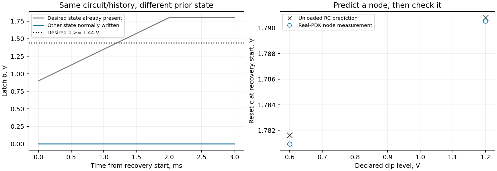

# Check the voltage and the state separately

The main notebook runs four matched latch simulations, then two RC checks.
The two extra dips are fixed at 0.6 V and 1.2 V before either run starts.
R, C, the normal write and timing stay fixed at TT/27 C.

The RC calculation ignores transistor loading. The allowed difference is 20 mV,
chosen for the lesson. It is not a physical model error bound. The predictions
and source hashes are saved before the runs. This is a local test plan, not an
independent registration or a claim that the conditions were never explored.

| Dip, V | Predicted c, V | Measured c, V | Error, mV | Voltage check | Reset restored the state |
|---:|---:|---:|---:|---|---|
| 0.6 | 1.781611 | 1.780938 | -0.673 | Pass | No |
| 1.2 | 1.790804 | 1.790542 | -0.263 | Pass | No |

Both normal writes are verified. Both reset tests miss. The voltage prediction
therefore explains the node without proving a working reset.

At the main 0.9 V dip, the retained and written-state RC traces differ by at
most about 1.47 uV at reset during recovery. The supply difference is at rounding
level. Nearly the same reset waveform accompanies two different prior states.
This is a finite numerical observation, not exact circuit equivalence or a
hardware switching threshold.

## Repeat the check

Run the main notebook for six new simulations. The prediction plan is written
before the two extra runs under `results/mechanism_runs/`. A prediction mismatch
stays a mismatch. An incomplete run has no functional verdict.

Run `python mechanism_evidence.py` after setup to check the six saved acquisitions
without SPICE. It verifies the raw archive, regenerates the decks and repeats
the measurements. The original prediction sources are retained, with their
hashes checked. The cleaned generators must still reproduce the same decks.
Software checks also reject an unmatched supply history and wrong predictions.

These are schematic simulations with ideal timing passives and pinned SKY130
models. They do not qualify a reset threshold, continuous voltage range or
hardware accuracy.
