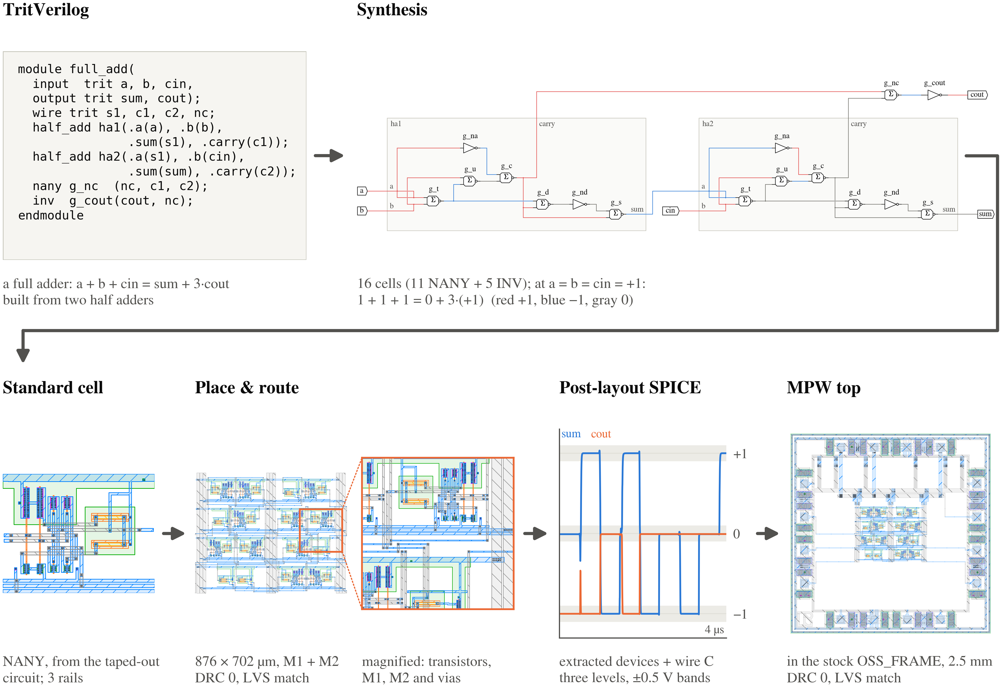

# TritFlow: Balanced-Ternary HDL to GDS on Japan's First Commercial Open-Source PDK

| Team member | Affiliation | Email |
|---|---|---|
| Einosuke Okazaki (岡崎 英之介), designated representative | Information and Communication Engineering Course, Department of Monozukuri Engineering, Tokyo Metropolitan College of Industrial Technology (KOSEN), Tokyo, Japan | einosukeokazaki@gmail.com |

If selected, Einosuke Okazaki will attend ISSCC 2027 in person and present the poster.

## Highlights

TritFlow is a design flow from ternary HDL to GDS, built on CMOS cells that handle three voltage levels directly. It runs on OpenSUSI TR-1um, the first open-source PDK released by a commercial semiconductor fab in Japan. The notebooks run ternary HDL through logic synthesis, two-metal place and route, GDS output, DRC/LVS, post-layout simulation and ternary timing analysis in order.

- **To our knowledge, the first ternary physical design flow from HDL to GDS**: one automated pipeline runs a dedicated ternary HDL (TritVerilog) → logic synthesis → two-metal place and route → GDS → DRC/LVS → post-layout SPICE → ternary timing analysis.
- **Physical balanced ternary**: without binary encoding, CMOS cells carry −1, 0 and +1 as the three voltages −5 V, 0 V and +5 V.
- **Manufacturable GDS**: the layouts pass the PDK's official DRC/LVS decks, and the flow generates a full-chip GDS with the MPW shuttle's frame and pads.
- **Standard cells from a taped-out design**: the cells are based on balanced-ternary logic circuits the author [taped out on OpenSUSI-TR10 in 2026](https://github.com/ishi-kai/ISHI-KAI_Multiple_Projects_OpenMPW_OpenSUSI-TR10-1/tree/c423666270668825b31866fa1f226f6df409e8f6/member_project/balanced-ternary-logic/PenguinEino). The chips are scheduled for delivery in January 2027, so simulation results can be compared directly with measurements.
- **Every step interactive on Colab**: schematics, layouts and waveforms of each step appear in place, and the HDL can be edited and rerun.
- **A flow on Japan's first commercial open-source PDK**: built on OpenSUSI TR-1um, it pushes forward the democratization of chip design in Japan.

## Notebooks

| Notebook | Language | Open in Colab |
|---|---|---|
| [tritflow_en.ipynb](tritflow_en.ipynb) | English |  |
| [tritflow_ja.ipynb](tritflow_ja.ipynb) | Japanese |  |

Both notebooks are saved with their outputs.

**Source code:** [github.com/PenguinEino/tritflow](https://github.com/PenguinEino/tritflow) (cell library, synthesis, place and route, verification and the notebook generator; the notebooks fetch commit [`092d3df`](https://github.com/PenguinEino/tritflow/tree/092d3df1be15959bece78eb8f8dc759880d1545d)).

## Running

Open a notebook in Colab and choose **Runtime → Run all**. On a fresh Colab CPU runtime this takes about 13 to 15 minutes, including setup. The first cell fetches the TritFlow source at a pinned commit of [PenguinEino/tritflow](https://github.com/PenguinEino/tritflow) and installs the tools at fixed versions:

- Python 3.12
- KLayout 0.30.6
- ngspice 42
- OpenSUSI TR-1um PDK, commit `5d963db`

## License

Apache-2.0 ([LICENSE](LICENSE)). The cell layouts are generated with the parameterized cells of the [OpenSUSI TR-1um](https://github.com/OpenSUSI/TR-1um) PDK (Apache-2.0; IP62 process data © 2025 TOKAI RIKA CO., LTD). The cell circuits come from the author's taped-out design [opensusi-tr10-balanced-ternary-logic](https://github.com/PenguinEino/opensusi-tr10-balanced-ternary-logic). References are listed at the end of each notebook.
