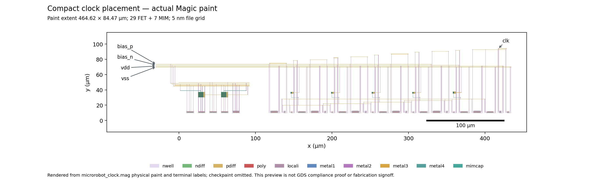

# One bounded compact clock placement

**Reviewed and accepted as compact-placement improvement evidence; no electrical design acceptance.** One compact placement passed the physical gates and exactly one new matched 4 ms / 25 ns transient completed. Frequency improves **13.34845%** over accepted stage-local routing, while whole measured power increases **1.18003%**. Actual paint bounding-box area decreases **24.52832%**. The remaining frequency is **45.61347%** of the schematic reference. These results do not establish application footprint, power or timing acceptance.

The opt-in `--placement compact_x` mode changes only x placement, keeping the accepted `--routing stage_local` strategy. The default placement and explicit `baseline` placement emit the historical generation Tcl bytes. Existing baseline and stage-local routing Tcl bytes also remain identical. Focused checks regenerate both accepted cases without invoking Magic or ngspice. Unknown placement modes are rejected. `generator.diff` records the generator change.

The existing PDK cell paint and actual pin centers were examined before applying the reviewed placement: the unchanged FET escape paint occupies x−2.485 through x+L+3.915 µm. Starting at x=120 µm and placing each next FET at x+L+9 µm leaves a **2.6 µm** horizontal gap between adjacent escape envelopes. Five stage origins are 120/173/226/279/332 µm, with ps/pi/ni/ns offsets 0/17/26.5/36 µm. Buffer origins are 385/402/419/429 µm. All FET origins remain at y=10 µm, in the same order. Timing MIM origins are x=145.75/198.75/251.75/304.75/357.75 µm, y=35 µm: each is the midpoint of its stage's pi/ni origins plus 4 µm.

All instance transforms and pin centers were verified as exact translations. Every generated cell MAG paint file matches the accepted stage-local cell after timestamp normalization. Bias MAG, physical source and track JSON remain byte-identical. FET sizing, connectivity, intentional MIM values and models are unchanged: canonical source SHA-256 remains `dc606bcaa35616e6412c2b8d8c63e17175f6b53d6baad820a222b66b74dc29de`, containing 29 FETs and seven MIMs. Extracted numbering, D/S orientation and node aliases change with placement; cap-only and resistor-collapsed RC device signatures were independently resolved to canonical logical nets and verified against canonical connectivity, models and w/l before simulation.

The stage-local horizontal a/b/c/d/raw M3 tracks remain at y=20/22/24/26/28 µm. Timing MIM C1 escape remains at y=30 µm. Existing `free_x` collision handling and all bias/routing rules remain unchanged. The actual geometry changes only through the translated entries and resulting rerendered routes. Extraction contains 851 resistors and 376 explicit capacitors, versus 851/374 for accepted stage-local routing.

Placement, native and GDS-roundtrip DRC all report **zero** errors. Native and roundtrip LVS match uniquely; both reject the deliberate wrong-net source. Streamout feedback is empty. These gates, translated-cell/pin checks and canonical-device checks passed before ngspice was invoked. Full reports, netlists, Tcl, MAG/GDS and logs are in `physical/`. Its `report.json` is the physical checkpoint; `electrical_executed=false` predates the separately recorded electrical invocation. The roundtrip negative control was run separately after physical generation and before simulation; no physical repair or additional placement was attempted.

| Case, all 25 ns | Clock Hz | Analog nW | First FF + feedback nW | Whole nW | Rail mean V | Rail min–max V | Steady Q rises / existing bench criterion |
|---|---:|---:|---:|---:|---:|---|---|
| Schematic, reused | 13054.161954 | 42.646796 | 0.937543 | 43.584339 | 1.774970 | 1.678951–1.823501 | 10 / true |
| Original RC, reused | 2927.580369 | 41.075002 | 1.641387 | 42.716389 | 1.739084 | 1.368941–1.825845 | 2 / false |
| Stage-local RC, reused | 5253.231493 | 43.037682 | 2.677762 | 45.715444 | 1.741963 | 1.473867–1.822547 | 5 / true |
| Compact x RC, new | 5954.456439 | 43.670458 | 2.584443 | 46.254901 | 1.743184 | 1.516540–1.820724 | 5 / true |

All baselines reuse existing full transients, with deck and data hashes checked against accepted stage-local evidence. Power and rail means integrate full data over exactly 2.4–4 ms, using trapezoidal integration and linear boundary interpolation. The original sample-index bench metrics are retained separately. Internal bias-reference power is unavailable. The sustained >=0.4 ms audit gives Q/clock frequency ratio **0.500000000654**, with exactly two clock rises between every successive Q rise. The unchanged bench criterion passes; it is not an application acceptance criterion.

| Canonical logical net | Stage-local incident explicit C, fF | Compact x incident explicit C, fF |
|---|---:|---:|
| a | 24.38027 | 18.73040 |
| b | 25.07066 | 19.33534 |
| c | 26.26128 | 22.40915 |
| d | 31.15221 | 26.04099 |
| raw | 83.95085 | 71.34341 |
| buffered | 55.20998 | 55.33407 |
| clk | 31.90274 | 30.07693 |

This accounting sums explicit parasitic capacitors incident on resistor-connected nets, resolving extracted aliases through verified canonical device connectivity. For example the compact `buffered` alias is `Xbp2.G`, while accepted stage-local uses `Xbp1.D`; compact `d` uses `X4_Xpi.D`, while accepted stage-local uses `Xc4.C1`. The alias map is retained in `metrics.json`. Intentional MIM and model capacitances are excluded. These incident sums ignore coupling correlation and are not ground-equivalent load. The finite PV rail changes with the circuit. The results provide no additive causal attribution of frequency recovery.

Actual paint extent is **464.615 × 84.465 µm**, area **39243.705975 µm²**, versus stage-local **615.615 × 84.465 µm**, area **51997.920975 µm²**. Checkpaint is omitted. This is a physical paint bounding box, not application footprint or fabrication signoff. The existing actual-Magic-paint renderer was reused; the generated preview was visually inspected. It shows the shortened FET row and translated timing MIMs, unchanged bias macro and the remaining upper supply/internal/output tracks.



The new full transient has **169690 rows and eight finite columns**, starts at zero, has nondecreasing time and reaches exactly 0.004 s. No abort, `doAnalyses:` or timestep-too-small marker occurs. Simulator return code is zero after **46.800246 s**, within the unchanged 180 s timeout. The known PDK multiplier hierarchy warning remains. Completion is established from full data and logs. The largest observed time difference is 25.0002 ns, reflecting output decimal precision around the requested 25 ns maximum timestep.

The accepted stage-local deck was reused by replacing only its embedded extracted RC subcircuit. `deck.diff`, `netlist.diff`, `routing.diff` and `placement.diff` record the changes. The receiver and `.spiceinit` hashes match the accepted deck; the PDK top-level library hash matches. Conditions remain tt, 26.85 °C, three fitted PV cells at assumed 150 µm²/cell scaling, 1 µs dark then 100 µs optical ramp, 2 pF storage, 2 fF output load, real SKY130 DFF and feedback inverter, Gear order 2, reltol 1e-6, abstol 1e-15, zero-supply operating point without UIC or seeded voltages.

Executed from the repository root:

```text
MPLCONFIGDIR=/tmp/opentcad-mpl .venv/bin/python -m examples.microrobot.clock_layout --output examples/microrobot/local_runs/clock_layout/compact_x_v1 --routing stage_local --placement compact_x
MPLCONFIGDIR=/tmp/opentcad-mpl .venv/bin/python -u examples/microrobot/results/clock_compact_placement/run_variant.py
MPLCONFIGDIR=/tmp/opentcad-mpl .venv/bin/python examples/microrobot/results/clock_compact_placement/plot_layout.py
MPLCONFIGDIR=/tmp/opentcad-mpl .venv/bin/python examples/microrobot/results/clock_compact_placement/run_variant.py --audit-only
MPLCONFIGDIR=/tmp/opentcad-mpl .venv/bin/python examples/microrobot/results/clock_compact_placement/verify.py
```

The separate roundtrip control called the existing `clock_layout.lvs()` helper in `compact_x_v1/gds_roundtrip`, against `compact_x_v1/negative_control.spice`, with report stem `negative_control_lvs`; it rejected the wrong-net source. `run_variant.py` reuses the accepted one-shot execution and full-data audit functions. Its physical input assertions run before it creates a fresh electrical directory and invokes ngspice once. A separate read-only preflight evaluated the same input assertions before that command. `--audit-only` refreshes evidence with zero simulator invocations. `verify.py` checks compatibility, gates, exported manifest, completion and preview extents without simulating. Helper hashes and all exported files are recorded; `sha256.json` excludes itself and Python caches.

This is one placement and one timestep; it is **not convergence-qualified**. No PVT, mismatch, storage sweep, remaining divider, POR, driver or footprint qualification was performed. Full `clock.dat` remains under `local_runs/clock_layout/compact_x_v1/extracted_25ns/`; raw transients and local PDFs are excluded from compact results. No submission, publication, push, commit or fabrication was initiated.
