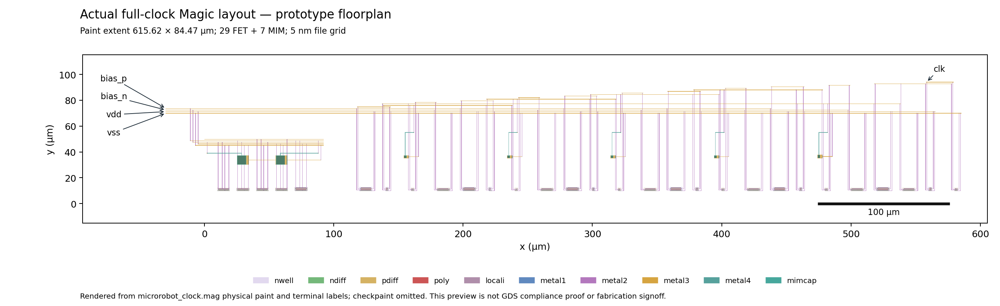

# Preliminary clock layout electrical review

**Not accepted. Awaiting Astra review.** This records the already-reviewed matched 4 ms experiment. No circuit, sizing, placement, routing, tolerance, startup or stop-time changes were made. Existing physical gates passed for this prototype; electrical performance and application suitability remain for review.

The canonical source SHA-256 is `dc606bcaa35616e6412c2b8d8c63e17175f6b53d6baad820a222b66b74dc29de` (29 FET, 7 MIM). The physical schematic source is `177c33e94de6e60c043e8d903ecd7c0e7d4f96e3aaf8e8093b7059392b48f01a`; the RC netlist is `f5491783e4294a96d925a4674d76ce188e1333e018c80b41d02dbe212f75b9ea` (851 R, 374 explicit C). Actual decks, receiver library, logs, physical gate evidence and input snapshots are included. `sha256.json` hashes exported files; `review_metrics.json` also hashes local full transients without exporting them.

| Case | Full-data rows | Clock Hz | Analog nW | First FF + feedback nW | Whole clock + receiver nW | Existing bench `passed` |
|---|---:|---:|---:|---:|---:|---|
| Schematic 50 ns (existing) | 106174 | 13053.579604 | 42.647188 | 0.937851 | 43.585039 | true |
| Schematic 25 ns (new) | 182756 | 13054.161954 | 42.646824 | 0.937545 | 43.584369 | true |
| Extracted 50 ns (existing) | 84895 | 2927.306330 | 41.097005 | 1.643184 | 42.740189 | false |
| Extracted 25 ns (new) | 164309 | 2927.580382 | 41.072836 | 1.641413 | 42.714249 | false |

All four full transients have eight finite columns, start at zero, have nondecreasing time and reach exactly 0.004 s. Logs have no abort/timestep-too-small markers. New simulator invocations returned zero; fresh-case wall times were 49.04 s and 64.19 s, with a 180 s simulator timeout and 220 s outer bound. Existing 50 ns execution wall times/exit codes were not independently recorded; their completion is established from full data and logs. All logs contain the PDK `m=xx` hierarchy warning and completed dynamic gmin stepping.

The two new runs used the unchanged `local_runs/clock_layout/run_electrical.py`: tt, 26.85 °C, three fitted PV cells at assumed 150 µm²/cell scaling, 100 µs optical ramp after 1 µs dark, chosen 2 pF supply storage, 2 fF output load, real SKY130 DFF and feedback inverter, Gear order 2, reltol 1e-6 and abstol 1e-15. Startup begins at the zero-supply operating point, without UIC or a seeded node. Separate internal bias current is unavailable; whole analog macro and receiver power are measured. Power integrals use the full-data steady window t > 2.4 ms, not preview samples.

The relative change `abs(50ns - 25ns)/abs(25ns)` is 0.004461% in schematic frequency and 0.001537% in schematic whole power; extracted changes are 0.009361% and 0.060730%. All meet the reviewed <1% timestep criterion. Analog and first-stage power changes also remain below 1%. Each matched deck differs only in the two timestep fields of `tran` (`5e-08` to `2.5e-08`); start and 4 ms stop are identical. The complete diffs and emitted deck hashes are in `review_metrics.json`. This establishes timestep consistency for this bench, not electrical acceptance. Extracted frequency is only 22.426% of schematic frequency at 25 ns.

The extracted divider toggles. At 25 ns its Q rises at 2.905160229 ms and 3.588317760 ms in the fixed 2.4–4 ms steady window; the existing bench requires at least three Q rises before reporting its frequency, hence the null metric and `passed=false`. The full-data sustained audit (edges from 0.4 ms onward, without extending the simulation) gives Q frequency 1463.789600 Hz and Q/clock ratio 0.499999940, with exactly two clock rises between each consecutive pair of Q rises. The corresponding 50 ns ratio is 0.499999819. The two steady-window Q rises alone give one period, an observation with less coverage than the sustained audit. These edge observations do not establish PVT or minimum-rail qualification. All raw startup threshold crossings remain listed; those near zero supply are excluded from the sustained audit. Edge offsets are threshold observations, not characterized propagation delay.

At 25 ns the schematic steady rail spans 1.678951–1.823501 V and the extracted rail spans 1.368941–1.825845 V. Their time-averaged rails are 1.774970 V and 1.739086 V. The original bench's `steady_supply_V` is a sample mean on adaptive time points (1.767259/1.732551 V); the report labels it separately from time average. Rail droop remains visible and unqualified.

Offline RC accounting identifies incident explicit parasitic C sums of 73.688/70.216/70.797/71.993 fF on timing nodes a/b/c/d, 145.300 fF on raw, 63.038 fF on buffered, and 31.903 fF on clk. Raw-to-vss accounts for 93.193 fF, raw-to-a 14.102 fF and raw-to-d 8.392 fF. Nodes are grouped only through explicit resistor connectivity, and endpoint identities follow the cap-only extraction topology. These are diagnostics: they exclude intentional MIM devices and transistor-model capacitances, ignore coupling correlation and do not predict a ground-equivalent load, delay, or causal contribution to the slowdown. The capacitance breakdown and limitations are in `review_metrics.json`.



The preview renders actual flat `microrobot_clock.mag` physical rectangles, excluding checkpaint, with terminal labels and a 100 µm scale. SKY130 CIF scale 10 nm and `magscale 1 2` imply 5 nm per coordinate, consistent with the layout generator. Paint extent is 615.615 × 84.465 µm. This is a prototype floorplan preview, not GDS compliance proof or footprint/fabrication signoff. Native/roundtrip DRC/LVS evidence is preserved under `provenance/`; its historical `report.json` predates the electrical runs and is not rewritten.

Executed commands:

```text
.venv/bin/python -u examples/microrobot/results/clock_layout_review/run_matched.py
.venv/bin/python examples/microrobot/results/clock_layout_review/audit.py
.venv/bin/python examples/microrobot/results/clock_layout_review/plot_layout.py
.venv/bin/python examples/microrobot/results/clock_layout_review/verify.py
```

`run_matched.py` refuses to reuse an existing run directory. `audit.py` only reads local full transients and writes compact evidence. `plot_layout.py` only renders the copied MAG snapshot; the PNG was visually checked. Matplotlib used a temporary font cache because user/system cache paths were unwritable; rendering completed. A process inventory command was sandbox-denied, and no process was restarted or terminated. No submission, publication, push, commit or fabrication was initiated. No raw transient or local reference PDF is exported here. PVT, mismatch, the remaining divider, POR, drivers and application footprint closure remain outside this experiment.
