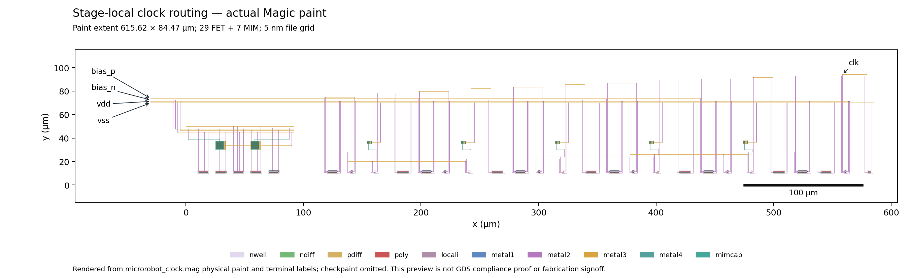

# One stage-local clock routing variant

**Reviewed and accepted as routing-improvement evidence; no electrical design acceptance.** One physical variant and exactly one new matched 4 ms / 25 ns transient were evaluated. The schematic and original RC baselines were reused, with full-data hashes checked against the reviewed evidence.

The opt-in `stage_local` generator moves only a/b/c/d/raw M3 horizontal tracks from 76/80.8/84.4/88/77.2 µm to 20/22/24/26/28 µm and their MIM C1 M4 escape level from 55 to 30 µm. M2 terminal drops connect to these lower tracks. Placement, transistor sizing, all seven intentional MIM devices, bias macro, terminal escape x coordinates, other routing and interfaces remain unchanged. Fixed placement still requires a long raw feedback connection between stage 5, stage 1 and the output buffer. This experiment does not close the floorplan.

The default `baseline` mode emits the exact historical routing Tcl bytes, including the Magic completion trailer; focused checks also compare tracks and reject an unknown routing mode. Physical source, bias MAG and instance-pin JSON are byte-identical to baseline. The placement MAG is identical after normalizing timestamps. Cap-only extracted device lines, including connectivity and dimensions, match baseline exactly. The source hash remains `dc606bcaa35616e6412c2b8d8c63e17175f6b53d6baad820a222b66b74dc29de`.

Placement/native DRC report zero errors. Native LVS and GDS-roundtrip LVS match uniquely; GDS-roundtrip DRC reports zero errors. The deliberate wrong-net negative control is rejected and streamout feedback is empty. These gates passed before ngspice was invoked. Extraction retains 29 FETs, seven MIMs, 851 resistors and 374 explicit capacitors. Full gate reports, Tcl, logs, physical source, MAG/GDS and extracted netlists are in `physical/`. Its `report.json` is the physical-generation checkpoint, so its `electrical_executed=false` field predates the separately recorded electrical run.

| Case, all 25 ns | Clock Hz | Analog nW | First FF + feedback nW | Whole nW | Rail mean V | Rail min–max V | Steady Q rises / existing bench criterion |
|---|---:|---:|---:|---:|---:|---|---|
| Schematic, reused | 13054.161954 | 42.646796 | 0.937543 | 43.584339 | 1.774970 | 1.678951–1.823501 | 10 / true |
| Original RC, reused | 2927.580369 | 41.075002 | 1.641387 | 42.716389 | 1.739084 | 1.368941–1.825845 | 2 / false |
| Stage-local RC, new | 5253.231493 | 43.037682 | 2.677762 | 45.715444 | 1.741963 | 1.473867–1.822547 | 5 / true |

Power and rail means integrate full data over the exact common 2.4–4 ms interval, with linear interpolation at boundaries, using the previously reviewed ablation audit method. The original bench sample-index metrics are separately retained in `metrics.json`. Separate internal bias-reference power is unavailable.

Frequency rises **79.439%** from the original RC baseline and reaches **40.242%** of schematic frequency. Whole power rises **7.021%** from original RC. The rail minimum improves in this case but remains unqualified. The sustained audit from 0.4 ms gives Q/clock frequency ratio **0.500000001**, with exactly two clock rises between every pair of successive Q rises. The unchanged bench requires at least three steady Q rises; this variant has five. That criterion passing does not establish application acceptance.

| Logical net | Baseline incident explicit C, fF | Stage-local incident explicit C, fF |
|---|---:|---:|
| a | 73.68847 | 24.38027 |
| b | 70.21555 | 25.07066 |
| c | 70.79672 | 26.26128 |
| d | 71.99337 | 31.15221 |
| raw | 145.30037 | 83.95085 |
| buffered | 63.03805 | 55.20998 |
| clk | 31.90274 | 31.90274 |

These are sums of explicit capacitance incident on resistor-connected nets, using anchors verified by the unchanged cap-only device connectivity. They exclude intentional MIM and transistor-model capacitance, ignore coupling correlation, and are **not ground-equivalent loads**. Other incident sums can change through coupling even though their routing is unchanged. The finite PV rail also moves with the circuit. Neither the frequency recovery nor these sums provide an additive causal attribution of the remaining slowdown.

Paint extent remains **615.615 × 84.465 µm**, bounding-box area **51997.920975 µm²**. This is actual physical paint extent, omitting checkpaint; it is not application footprint or fabrication signoff.



The existing reviewed renderer was reused and the generated preview visually checked. The preview shows the shortened low timing routes and the unchanged upper power/bias/internal/output routing.

The new full transient has **168547 rows, eight finite columns**, starts at zero, has nondecreasing time and reaches exactly **0.004 s**. The simulator returned zero in **46.043672 s**, within the unchanged 180 s simulator timeout. Full-data auditing found no abort, `doAnalyses:` or timestep-too-small marker. The log retains the known PDK `m=xx` hierarchy warning and successful dynamic gmin stepping. Completion is established from full data and logs, independently of exit status.

The reviewed extracted 25 ns deck was reused by replacing only its embedded extracted RC subcircuit. `deck.diff`, `netlist.diff`, `routing.diff`, saved input snapshots and hashes record the transformation. Supply, receiver, initialization, tolerance, startup, integration method and load settings are unchanged: tt, 26.85 °C, three fitted PV cells at assumed 150 µm²/cell scaling, 1 µs dark then 100 µs optical ramp, chosen 2 pF storage, 2 fF output load, real SKY130 DFF and feedback inverter, Gear order 2, reltol 1e-6, abstol 1e-15, zero-supply operating-point startup without UIC or seeded voltages. The PDK top-level library hash matches baseline.

Executed from the repository root:

```text
MPLCONFIGDIR=/tmp/opentcad-mpl .venv/bin/python -m examples.microrobot.clock_layout --output examples/microrobot/local_runs/clock_layout/stage_local_v1 --routing stage_local
.venv/bin/python -u examples/microrobot/results/clock_local_routes/run_variant.py
MPLCONFIGDIR=/tmp/opentcad-mpl .venv/bin/python examples/microrobot/results/clock_local_routes/plot_layout.py
MPLCONFIGDIR=/tmp/opentcad-mpl .venv/bin/python examples/microrobot/results/clock_local_routes/verify.py
```

An initial pre-execution input check rejected timestamp-only differences in regenerated `clock_cells.mag`; the check was corrected to normalize timestamp records, and no simulator was invoked by that failed attempt. The successful electrical command created a fresh `local_runs/clock_layout/stage_local_v1/extracted_25ns` directory and invoked ngspice once. `run_variant.py --audit-only` can refresh compact evidence without invoking a simulator. `verify.py` performs focused evidence/default-compatibility checks without a simulator. `sha256.json` covers exported files except itself.

The variant has one timestep and is **not convergence-qualified**; baseline convergence evidence does not qualify it. No PVT, mismatch, storage sweep, remaining divider, POR, driver or footprint qualification was performed. Raw `clock.dat` remains local; no raw transient or local reference PDF is exported. No submission, publication, push, commit or fabrication was initiated.
