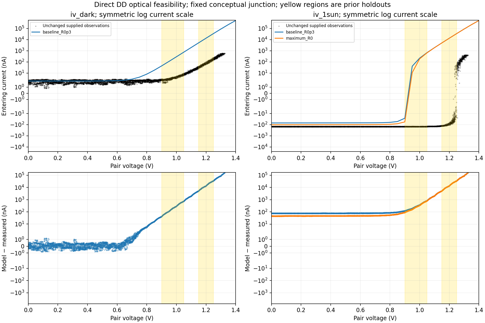
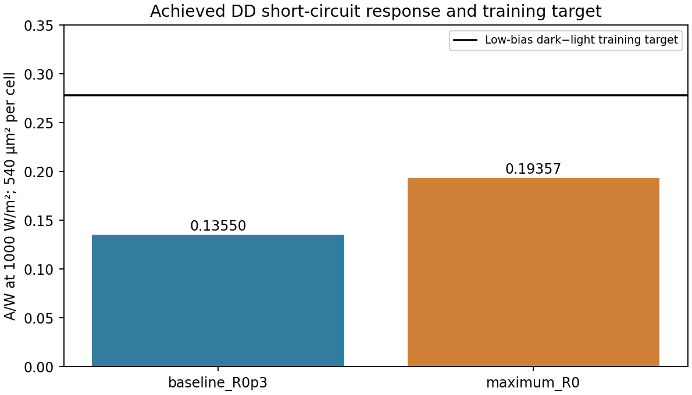

# Direct-DD PV calibration feasibility

**Reviewed and accepted as fixed-structure optical-throughput feasibility evidence; reflection-only calibration infeasible; physical PV calibration incomplete.** No application defaults or core physics changed. This milestone is a conditional optical-throughput feasibility check, not process identification or a completed PV calibration.

Actual S2E training target: equal mean of dark-minus-light means in two 25 mV pair-voltage bins covering **0 ≤ Vpair < 0.05 V**: **150.060119 nA**, or **0.277889110 A/W**. Separate acquisitions are binned by voltage, never paired by row. Native current observations, acquisition order and repeated-voltage scatter remain unchanged. A constant shared dark/light observation offset is assumed to cancel in this difference. The diagnostic shared entering-current offset, estimated only from the same dark low-bias training bins, is 1.980933 nA; it is not a verified instrument correction and is excluded from device Isc/Voc/MPP.

| Direct DD curve | Effective R | Isc response A/W | Pair Isc nA | Pair Voc V | Pair sampled Pmax nW |
|---|---:|---:|---:|---:|---:|
| baseline_R0p3 | 0.300000 | 0.135497 | 73.1685 | 0.921164 | 52.0240 |
| maximum_R0 | 0.000000 | 0.193569 | 104.5272 | 0.943366 | 76.4129 |

Two equal 540 µm² cells in series: **Vpair = 2 Vcell; Ipair = 540 Iper_um²**. There is no factor of two in current. Both fresh sweeps cover 29 points from 0 to 0.70 V/cell, stepping 25 mV/cell; the resulting 50 mV pair grid limits interpolated Voc and sampled MPP accuracy. Optical input is 660 nm, 1000 W/m², α = 3000 cm⁻¹, unity pair yield and single-pass Beer–Lambert generation. Fixed structure: 3 µm Si, 0.3 µm n emitter (ND = 1e18 cm⁻³), 2.7 µm p base (NA = 1e16 cm⁻³), full-width ideal transparent ohmic top/back contacts, insulating sides, 300 K, SRH τn = τp = 1e-5 s, existing default transport/statistics. These are conceptual assumptions, not measured process parameters. No temperature, doping, thickness, absorption, lifetime, area, Rs/Rsh or contact physics was fitted.

The physical R range is [0,1]. At R=0 the achieved low-bias model photocurrent is **104.452279 nA**, short by **30.393%** of the training target. The linearized required effective reflectance is **-0.436638** and the R=0 input multiplier would be **1.436638**. These quantify the discrepancy; an unphysical R or increased irradiance is not accepted as calibration. The candidate run decision is determined only by the low-bias target and physical bounds. The target is not bracketed: third DD candidate skipped, and the bounded optical family is infeasible.

The R=0 analytical absorbed-photon ceiling is 0.315898340 A/W. Achieved Isc uses 61.276% of it; the target would require 87.968% collection at the assumed absorption. A photon ceiling alone therefore cannot diagnose the missing structure or collection. Required additional evidence: measured thickness/emitter and doping profiles, contact geometry/selectivity and surface/interface recombination, actual wavelength/irradiance and illuminated active area, reflection/transmission or absorption information, plus dark IV and temperature/offset characterization. The required-current ratio is a discrepancy indicator, not a unique proposal for changing thickness, absorption, area or collection physics. No fabricated parameter identification is made.

Photon budget, finite complete grids, both terminal currents at every fresh voltage, and fresh-baseline/archive regression are checked in metrics.json. Baseline maximum scaled current change is 0. Terminal conservation tolerance is 1e-20 A/µm² absolute plus 1e-5 times the local terminal-current scale. Core solver equations/sweep are unchanged; an application-local subclass reads both contacts after each successful voltage point. Archived dark/mesh/lifetime curves pass recorded parameter/grid/photon-limit checks. Their contemporaneous source hashes and per-voltage terminal audits are unavailable: fresh baseline agreement supports conditional reuse, not proof of historical source identity. No new dark, mesh or lifetime sweep was run.

Training and holdout residuals against unchanged observations are recorded separately for dark and light. Existing holdouts [0.90,1.05) and [1.15,1.25) V are retained; they were previously inspected and are **not a fresh blind validation set**. All negative-voltage observations are excluded from DD residual evaluation because no negative-voltage extrapolation is allowed. The residual sign is model entering current plus shared offset minus measured entering current. R=0 illuminated holdout equal-bin RMS is 11791.373462 nA. The fixed dark shape and Voc/MPP remain independent reasons a photocurrent-only fit could not promote this model. No numerical pass tolerance for experimental accuracy is claimed without measurement uncertainty and a calibrated structure. Observed MPP is a noisy maximum sample and observed zero-current crossings are an acquisition-order distribution, not a unique reference Voc.




## Reproduction and scope

Executed with the existing repository .venv; package versions, UTC time, runtime, executing source hashes, source/archived-data hashes and DD tables are in metrics.json and dd_curves.json. Local source identity is checked against the prior read-only inventory. Local hashes do not independently authenticate the user-reported data authorship/archive version/license. No source data, local PDFs or raw SPICE transients are included.

```sh
.venv/bin/python -m examples.microrobot.pv_calibration --source-dir <USER_HOME>/Downloads/Reynolds-2022-data --output /tmp/new-pv-feasibility
.venv/bin/python -m pytest tests/integration/test_pv_calibration.py -q
```

The output must be new or empty and outside the input directory. No network access, package installation, full system/circuit rerun, submission, fabrication, publication or push was performed. requirements.txt records the actual relevant installed versions for reproduction; it is not an independently tested clean-environment lockfile.

Validation: 58 relevant tests passed (including 9 new focused checks); Ruff passed for the owned modules/tests. The existing archive refusal returned exit 2 and preserved artifacts. [execution_checks.json](execution_checks.json) records the exact one-line README-generator source cleanup after numerical execution, its executed/final hashes, timing scope and final checks. No further calibration DD sweeps were run.
