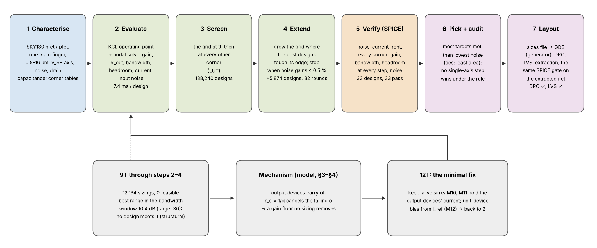
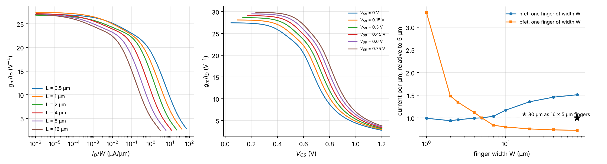
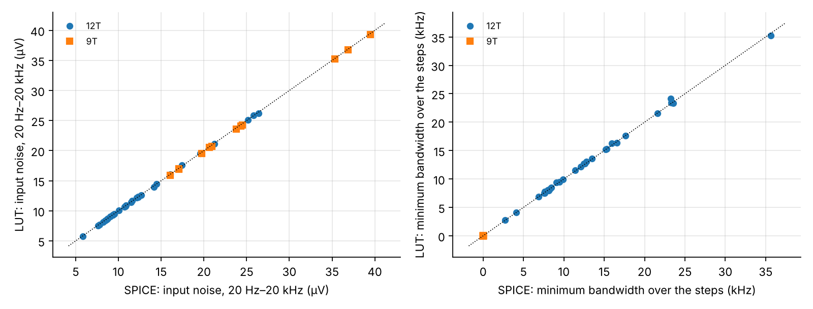
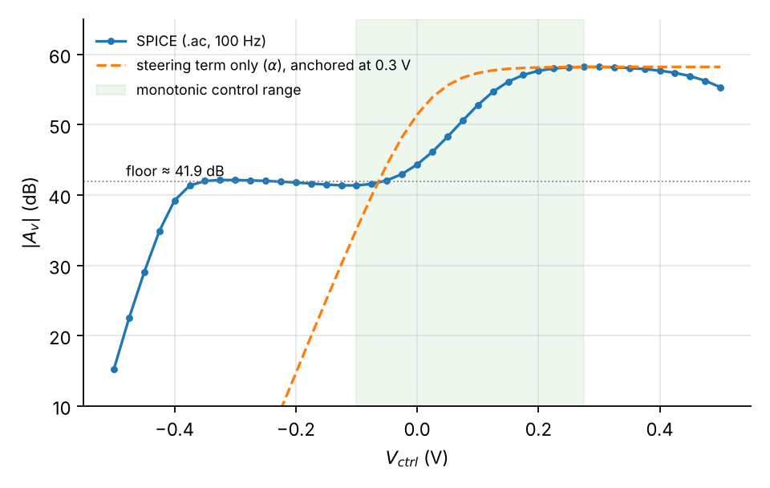
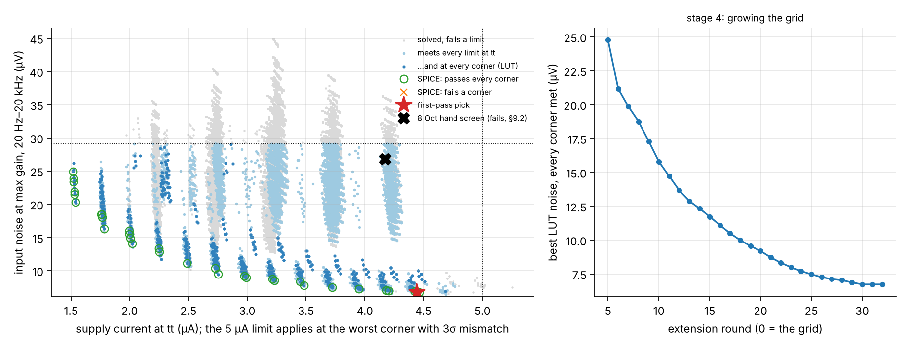
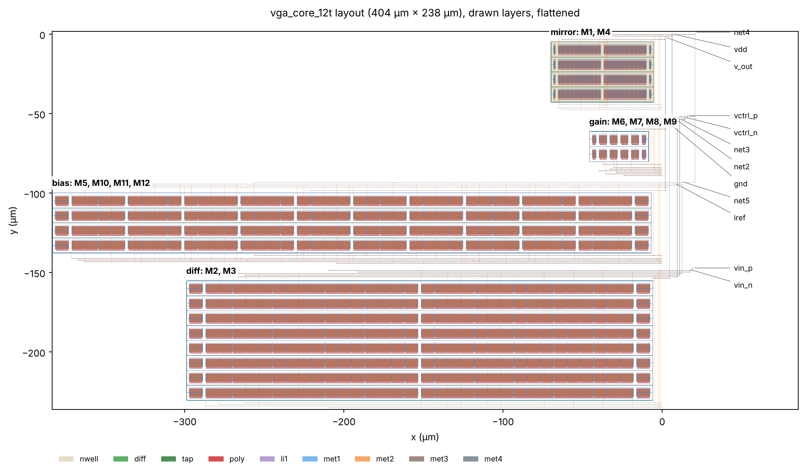
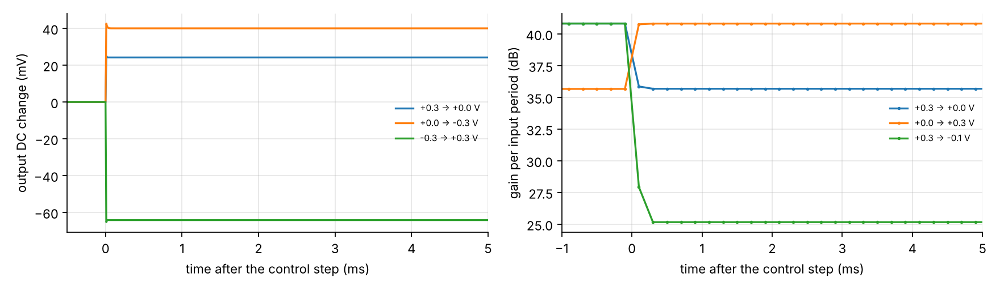

# Subthreshold current-steering VGA core + finger-exact gm/ID lookup-table flow (SKY130)

IEEE SSCS Code-a-Chip, ISSCC 2027. Notebook: `notebook.ipynb`. License: Apache-2.0.

 runs tier 1 (cached results, no SPICE).

**Scope:** the gain core of a hearing-aid compressor and the flow that sizes it. No envelope detector or gain-control
loop, so no compression behaviour is claimed.

## What this work adds to the flows it reuses
**SKY130's device models depend on the width of each finger, so we build every transistor from whole 5 µm fingers. That makes a $g_m/I_D$ lookup table exact, and the flow built on it sized a subthreshold VGA core, showed where the hand-sized design fails, and was run again after the first layout broke its own pick.**

1. **Exact tables, with measured error.** Current density at fixed bias differs by up to 1.6× (NMOS) and 4.6× (PMOS) between finger widths, so a table made at one width does not carry to another. With whole fingers it does. The model on the tables takes 7.4 ms per design and corner and is within **0.40 dB** (gain) and **1.3 %** (noise) of SPICE on 42 random designs. Its worst bandwidth over-estimate is 17 %, so SPICE decides every pick (§5–§6).
2. **The hand-sized nine-transistor core cannot reach the 30 dB control range, and the flow says why.** None of 12,164 sizings does (best 10.4 dB). The output devices starve as the gain falls (§3.4, §7).
3. **A designer's three-transistor fix, then a design that meets every corner.** Two keep-alive sinks and a reference diode remove the starvation (§8). On the 12-transistor core, none of the 138,240 designs of the starting grid met all 24 corners; the search extension found the first one in round 5. The pick passes all 24 gate corners and 21 of 21 stress corners: control range ≥ **47.0 dB**, bandwidth ≥ **11.8 kHz**, headroom ≥ **173 mV**, supply **4.63–4.83 µA** (§9–§10).
4. **Layout in the loop, then sign-off.** The first layout put 207 fF of wiring on the output and the first pick failed at 6 of 24 corners; the wiring went back into the flow and the new pick passes (§9.3). The final layout is DRC-clean on 3 rule decks natively and 2 in IIC-OSIC-TOOLS, LVS-clean with device sizes in both runs (6 of 6 deliberately altered netlists rejected), with 0 Magic antenna violations. Its extracted netlist passes all 24 corners (bandwidth ≥ 12.3 kHz); with resistance extracted too it passes the gate at the 3 corners that bound it (§13).
5. **What does not hold.** The pick misses the noise-density target: 60 against 50 nV/√Hz at 1 kHz. Its 6.88 µV of integrated noise meets the 7 µV target at tt only (8.4 µV at the noisiest corner). Supply is 4.95 µA with 3σ mismatch against a 5 µA limit. Monte Carlo, the control port, PSRR and CMRR are schematic-level, and Monte Carlo passes behind an ideal output DC servo that is not built. There is no envelope detector or gain loop: this is a gain core, not a compressor (§14).

| From hand-sized to flow pick | 9T baseline (hand) | 12T hand screen (8 Oct) | 12T flow pick |
|:--|:--:|:--:|:--:|
| Control range in the bandwidth window, worst corner (dB) | -9.1 | 18.4 | 47.0 |
| f-3dB at maximum gain, worst corner (kHz) | 2.6 | 12.9 | 34.3 |
| Headroom, every step, worst corner (mV) | 4 | -63 | 173 |
| Corners passing the gate | 0 of 24 | 0 of 24 | 24 of 24 |
| Integrated input noise, max gain, tt (µV) | 29.1 | 26.8 | 6.9 |
| Supply current, worst corner (µA) | 6.18 | 5.64 | 4.83 |
| Drawn gate area (µm²) | 75 | 398 | 17,120 |

## Results in detail
A **finger-exact $g_m/I_D$ lookup-table flow** that takes a specification to a SPICE-verified subthreshold current-steering
VGA core in open SKY130, and the core it produced. Every transistor is built from identical 5 µm fingers, so the
device tables are exact. The circuit model on them runs in 7.4 ms per design and corner and stays within
**0.40 dB** (gain) and **1.3 %** (noise) of SPICE on 42 random designs; its worst
bandwidth over-estimate is 17 % (Table 9b), so SPICE decides every pick.

**The hand-sized nine-transistor core cannot meet the specification:** none of 12,164 sizings reaches the 30 dB
control range (best 10.4 dB), and the flow reports range as a limit no solved design meets. The analysis of
§3.4 explains why (the output devices starve as the gain falls), and a designer added **two keep-alive sinks and a reference
diode**. On that 12-transistor core, **none** of the 138,240 designs of the starting grid met all 24 corners;  the search extension grew the grid for 32 rounds (5,874 more designs), found the first design meeting every corner in round 5 and lowered the best noise to 6.72 µV (LUT).

**Layout in the loop:** a first layout (drawn for an interim sizing) puts 207 fF of wiring on the output; with it, the first pass's pick fails at 6 of 24 corners (bandwidth at the lowest gain step), and every design of that pass sits too close to the bandwidth margin to absorb it. The fitted equivalent, 0.3 pF, becomes part of the load and the flow runs again: 35 of 35 verified designs pass, and the new pick passes every corner with that layout's extracted capacitors added (and with them scaled ×1.5).

**The final pick** passes all 24 gate corners and 21 of the 21 other corners of the process × temperature ×
supply grid: control range ≥ **47.0 dB**, bandwidth ≥ **11.8 kHz** with the wiring allowance, supply
**4.63–4.83 µA** (≤ 5 µA with 3σ of bias mismatch), headroom ≥ **173 mV** at every
control step. At tt it has **6.88 µV** of integrated input noise (up to 8.4 µV at the noisiest corner),
60 nV/√Hz at 1 kHz and NEF **4.08**, in 17,120 µm² of gate area, and meets
**6 of 7** graded targets; it misses noise density at 1 kHz (Table 20c).
Monte Carlo with the PDK's per-device mismatch model: **800 of 800**
dies pass the full gate at 4 corners behind an ideal output DC servo. Without a servo, 198 of 200 dies keep their headroom at the worst of these corners; the servo must source or sink 88 nA to cover 99.7 % of dies.

**Final layout** (§13, gLayout generator, from the frozen sizes): DRC-clean (3 rule decks natively, the 2 installed in IIC-OSIC-TOOLS) and LVS-clean, device sizes included, in both runs, whose LVS also rejects 6 of 6 deliberately altered netlists. Magic's antenna check finds **0** violations, and the official KLayout deck's off-by-default off-grid and floating-metal checks find **0**; each check flags its control (5, 4 and 2 flagged), and no KLayout antenna deck was run. The extracted netlist (724 transistor fingers as drawn, 44 of them dummies; 55 extracted capacitors, 49 non-zero) passes all 24 corners of the same gate: bandwidth ≥ **12.3 kHz** (worst at sf/85/1.62V), headroom ≥ 173 mV, 6.88 µV at tt, and it still passes with every extracted capacitor ×1.5. Its parasitics act like 236 fF on the output, inside the 300 fF allowance the sizes were frozen with. With resistance extracted too (68,749 resistors; 218–466 Ω from each signal pin to its farthest transistor, RC poles ≥ 0.88 GHz) it passes the gate at the 3 corners that bound it, its bandwidth within 0.02 % of the capacitance-only result.

## Specification compliance (SPICE, schematic level, 24 corners)

| Parameter | Target | 9T baseline (hand) | 12T hand screen (8 Oct) | 12T flow pick | met: 9T | met: hand 12T | met: pick |
|:--|:--:|:--:|:--:|:--:|:--:|:--:|:--:|
| Supply current, worst corner (nominal) | report | 6.18 µA | 5.64 µA | 4.83 µA | — | — | — |
| Supply current + 3σ local mismatch, worst corner | ≤ 5 µA | — | — | 4.95 µA | — | — | ✅ |
| Control range in the bandwidth window, worst corner | ≥ 30 dB | -9.1 dB | 18.4 dB | 47.0 dB | ❌ | ❌ | ✅ |
| f-3dB at every gain step in the window, worst corner (C_L 1 pF; the pick with the layout wiring added) | ≥ 10 kHz | — | 10.3 kHz | 11.8 kHz | ❌ | ✅ | ✅ |
| f-3dB at maximum gain, worst corner | report | 2.6 kHz | 12.9 kHz | 34.3 kHz | — | — | — |
| Headroom V_DS at every control step, worst corner | ≥ 130 mV | 3.7 mV | -62.8 mV | 173.0 mV | ❌ | ❌ | ✅ |
| Corners passing the full gate (process, temperature, supply) | report | 0 of 24 | 0 of 24 | 24 of 24 | — | — | — |
| Maximum gain (tt) | report | 58.2 dB | 47.1 dB | 40.9 dB | — | — | — |
| Integrated input noise, max gain (tt) | ≤ 7 µV | 29.1 µV | 26.8 µV | 6.9 µV | ❌ | ❌ | ✅ |
| Input noise density at 1 kHz, max gain | ≤ 50 nV/√Hz | 348 nV/√Hz | 312 nV/√Hz | 60 nV/√Hz | ❌ | ❌ | ❌ |
| NEF, max gain | ≤ 5 | 11.3 | 14.9 | 4.1 | ❌ | ❌ | ✅ |
| Output swing at THD 1 %, max gain | report | 52 mV pk | 146 mV pk | 105 mV pk | — | — | — |
| Dynamic range at max gain (1 % THD swing over input noise) | report | 3.9 dB | 24.7 dB | 39.7 dB | — | — | — |
| Input offset, 1σ, max gain | report | 3.35 mV | — | 0.58 mV | — | — | — |
| Open-loop output DC spread, 1σ, max gain | report | 2621 mV | — | 65 mV | — | — | — |

## Claims and where they are tested

| Claim | Evidence (notebook) | Holds |
|:--|:--:|:--:|
| No 9T sizing meets the control-range gate | Tables 10c–10d | yes |
| Evaluator headroom error on random designs is inside the screen's headroom margin | Tables 9b, 10b | yes |
| Evaluator bandwidth over-estimate on random designs (17.4 %) is inside the screen's bandwidth margin (12 %); every pick is decided in SPICE either way | Tables 9b, 10b | no |
| Evaluator ranks designs as SPICE does (Spearman ≥ 0.99 for noise and bandwidth) | Table 9b | yes |
| Corner tables predict SPICE headroom and bandwidth inside the screening margins at every corner | Table 12b | yes |
| Every verified front design passes at every corner (both passes) | Tables 12, 17c | yes |
| The final pick passes every corner with the first layout's extracted capacitors added | §9.3 | yes |
| The final layout is DRC- and LVS-clean (device sizes included) in a native and a container run, and its LVS rejects every deliberately altered netlist | Tables 27, 27b | yes |
| The extracted final layout passes every corner of the gate, also with every extracted capacitor ×1.5 | Table 28 | yes |
| With resistance extracted too, the final layout passes the gate at the corners that bound the capacitance-only result | Table 28c | yes |
| The final layout has no Magic antenna violation and no finding of the official KLayout deck's off-by-default off-grid and floating-metal checks, and each check flags its control (a Magic antenna check; no KLayout antenna deck was run) | Table 27c | yes |
| The pick meets range, bandwidth, current and headroom at every corner, supply corners included | Table 17e | yes |
| The hand-screened 12T fails headroom mid-span | Table 16 | yes |
| With an ideal reference current, the pick's supply current moves by less than 5 % across corners | Table 17e | yes |
| Control range follows the steering law within 10 % at every temperature (SPICE/law ratio, law with the fitted n) | Table 18 | yes |
| PTAT-scaled control removes most of the temperature dependence | Table 18 | yes |
| The pick passes the gate at V_DD ± 10 % | Table 20 | yes |
| The search extension converged (stopped on its improvement criterion, not on the round limit) | Table 11b | yes |
| No single-axis step from the pick wins under the pick rule (checked in SPICE where the LUT says it might) | Table 17f | yes |
| Monte Carlo: every die passes the gate behind an ideal output servo, at tt and at the pick's most critical corners | Table 21b | yes |
| DC-match predicts the Monte Carlo open-loop output spread within 15 % | Tables 21, 21b | yes |
| The flow's supply-current mismatch sigma (1.00 %) matches Monte Carlo (1.05 %) within two standard errors of a 200-die estimate | Table 21b | yes |
| The LVS netlist reproduces the pick in SPICE | §9.4 | yes |
| Integrated input noise ≤ 7 µV at maximum gain, tt (the target's condition; every corner in Table 20b) | Table 23 | yes |

## The pick: devices and bias (every width is whole 5 µm fingers)

| Device(s) | Role | W (µm) | L (µm) | Copies m |
|:--|:--:|:--:|:--:|:--:|
| M2, M3 | input pair | 128 × 5 = 640 | 8 | 1 |
| M6–M9 | steering | 4 × 5 = 20 | 2 | 1 |
| M1, M4 | PMOS mirror | 128 × 5 = 640 | 0.5 | 1 |
| M5 | tail (unit copies) | 8 × 5 = 40 | 8 | 14 |
| M10, M11 | keep-alive sinks (unit copies) | 8 × 5 = 40 | 8 | 2 |
| M12 | reference diode (unit) | 8 × 5 = 40 | 8 | 1 |

| Bias | Value |
|:--|:--:|
| V_DD | 1.8 V |
| input common mode | 0.75 V |
| steering common mode | 1.05 V |
| reference current I_ref (into the iref pin) | 0.25 µA |

LVS reference netlist: `layout/vga_core_12t.spice` (generated by the notebook). Final layout: `layout/vga_core_12t.gds`
(gLayout generator in `layout/generator/`); sign-off reports, proof files and the extracted netlist in `layout/reports/`.

## Figures

**The flow**

**Device tables; current density versus finger width**

**Evaluator against SPICE**

**Hand-sized 9T: the gain floor**

**No 9T sizing meets the specification**

**The 12T flow: grid, extension and the first pass's pick**

**Layout in the loop: the first layout's wiring and the two picks**

**The final layout (layout/vga_core_12t.gds)**

**Gain law over temperature, with and without PTAT control**

**Noise of the pick**

**Monte Carlo with the PDK mismatch model**

**The control port: feedthrough and gain steps**

## Reproduce
* Tier 1 (Python only, about a minute): `pip install -r requirements.txt`, open `notebook.ipynb`, Run All.
* Tier 2/3 (IIC-OSIC-TOOLS container): `python tools/run_nb.py --mode spice` or `--mode full`; or set `RERUN_SPICE`,
  `REBUILD_LUT`, `RERUN_FLOW` in §2 and Run All. `python tools/run_flow.py` runs the flow alone and
  `python tools/verify_pick.py` the pick's Monte Carlo, control-port and stress checks.
* Layout: `python tools/run_nb.py --mode layout` (or `python tools/postlayout_pick.py --rerun`) reruns the post-layout
  gate on the committed extraction (ngspice + SKY130). DRC, LVS and extraction rerun with the layout author's scripts
  in `layout/generator/`, as in `layout/README.md` (IIC-OSIC-TOOLS); `python tools/import_signoff.py` reads their
  reports into `layout/layout_report.json`.
* Table 1 of the notebook records the toolchain of the last run; Table 1b where the flow caches were produced.

## Repository contents
`scripts/` all simulation and flow logic; `tools/` headless runners, the flow CLI and the lint; `cache/` the device
tables, screens and every simulation result; `images/` every figure; `schematic/` the xschem drawings of Figures 1
and 6 (`tools/schematics.py` writes the sizes in, checks them against the LVS netlist and renders the figures);
`layout/` the generated LVS netlist and sizes file, the final layout, its generator (`layout/generator/`) and sign-off
(`layout/reports/`); `layout/layout1/` the first layout (an interim sizing), whose extraction feeds §9.3.
